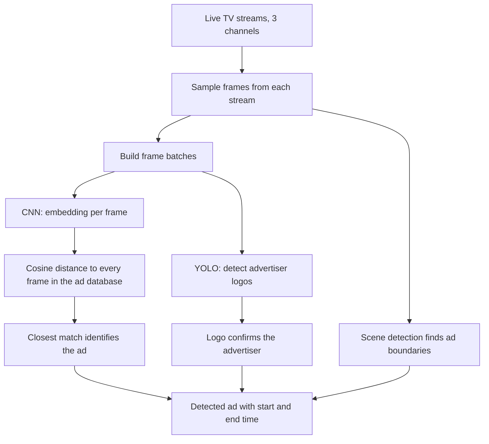

## What it does

Watches live TV channels and recognises, in real time, which advertisement is on air and when it starts and ends. The system ran on three channels at once.

## How it works

1. **Frame embeddings.** Frames are sampled from each live stream and passed through a convolutional neural network (CNN). The network's embedding is a compact visual fingerprint of the frame.
2. **Matching against an ad database.** The database holds embeddings for the frames of known ads. Each sampled frame's embedding is compared with every frame in the database by cosine distance, and the closest match identifies the ad being shown.
3. **Logo detection.** A YOLO model trained to detect company logos finds the advertiser's logo within the ad. This is combined with the embedding match to identify the ad currently being streamed.
4. **Timing.** A scene-detection algorithm finds the cuts where an ad begins and ends, giving each detection a start and end time.

## Deployment

- **ONNX on GPUs.** The models were exported to ONNX and served on GPUs, with multiple model instances running side by side.
- **Batched inference.** Frames were grouped into batches before inference, so many frames were processed in parallel instead of one at a time.
- **Concurrency.** This throughput let a single setup monitor three live channels concurrently.
