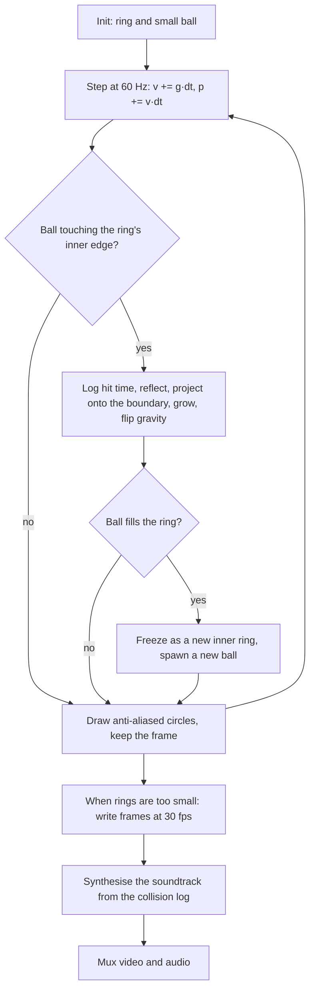

## What it does

Generates short-form "satisfying physics" videos. A small ball bounces inside a circular arena under diagonal gravity that reverses on every impact. Each wall hit grows the ball, thickens its outline and plays a tone that rises in pitch. When the ball can no longer fit, it locks into place as a new, smaller arena and a fresh ball spawns inside it. Rings nest inward until there is no room left, so the video ends by itself.

## Demo

This render is from a colour-cycling variant of the generator. Turn the sound on: every tone comes from a collision.

<video src="/work/bouncing-circles-video-generator/demo.mp4" poster="/work/bouncing-circles-video-generator/thumbnail.jpg" controls preload="metadata" playsinline style="width:100%;max-width:560px;display:block;margin:0 auto;border-radius:12px"></video>

## How it works

1. **Custom 2D physics.** Motion uses semi-implicit Euler integration. A collision is detected when the ball's centre distance reaches the ring's inner radius minus the ball's radius. The response is a damped reflection followed by a positional correction that projects the ball back onto the boundary at the impact angle.
2. **Nesting.** Every hit grows the ball and flips the gravity direction. When the ball fills the ring, it snaps to the centre as a new stationary ring and a new ball spawns, one step further along the colour palette.
3. **Rendering.** Pygame draws anti-aliased circle primitives at 60 Hz. Frames are decimated to 30 fps and encoded with OpenCV.
4. **Sample-accurate sound.** Audio isn't recorded live. Every collision is time-stamped in simulation time, and the soundtrack is synthesised afterwards at 44.1 kHz. Each hit is a 0.25 s sine tone with a linear decay, starting 200 Hz up and rising 50 Hz per hit, placed at the exact sample of impact. Sound and picture stay locked together however long the encoding takes. A live PyAudio preview plays the same tones during simulation.
5. **Muxing.** MoviePy and FFmpeg combine the lossless video with the soundtrack.
