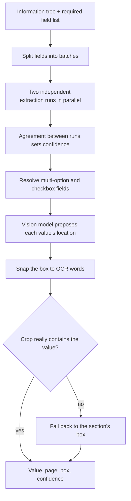

## The problem

Each client needs a different set of fields pulled out of their documents. Some are free text, some are yes/no, and some must be one of a fixed set of options. A value alone isn't enough. Reviewers need to see where on the page it came from and how sure the system is.

## What I built

I designed and built much of a configurable extraction service. It returns every requested field with a value, a page, a bounding box and a confidence score.

- **First version.** Fields were extracted page by page from page images. A consolidation agent merged the results across pages, and an option-resolution agent mapped answers onto their allowed values.
- **Second version.** Instead of reading raw pages, the service queries the structured "information tree" produced by the [digitization pipeline](/work/document-digitization): sections with their text, key-value pairs and checkbox states. This keeps prompts small and makes every answer traceable to a section.

### How it works

1. **Batched, concurrent extraction.** The pages that hold required fields are selected, and the fields are processed in batches.
2. **Self-consistency confidence.** Each batch is extracted twice by independent model runs. If the two answers agree under fuzzy comparison, the field gets high confidence. If they disagree, the field is marked for human review. A later quality-control stage, built with the team, adds a reasoned confidence level and a suggested correction.
3. **Option resolution.** Constrained fields, such as checkbox groups, are mapped onto their allowed options.
4. **Localization.** Finding where a value appears is a separate step. A vision-language model proposes a rough box on the page image, and the box is snapped to the OCR words inside the relevant section.
5. **Crop-and-verify.** Each box is cropped with padding and shown back to a vision model to confirm the crop contains the value. Boxes that fail fall back to the box of the enclosing section, so every field still points to the right part of the document.
