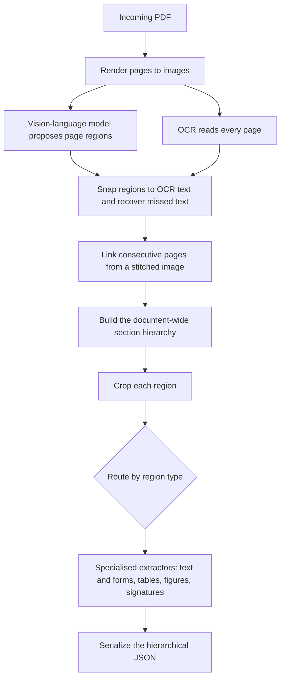

## The problem

Downstream systems such as redaction and data extraction need more than raw text. They need to know how a document is organised: where one document in a bundle ends and the next begins, which sections a page contains, how those sections nest, and what each region holds. A region might be a paragraph, a table, a form with checkboxes, or a signature. Scans make this harder, because layout has to be recovered from pixels.

## What I built

I worked on two generations of the digitization pipeline:

- **First generation (my design).** A layout-detection model found regions on each page, and OCR read the text. A set of LLM agents then built the structure on top:
  - one detected the sections
  - a verifier compared the page image with the sections found so far and recovered any that were missed
  - another arranged the sections into a hierarchy
  - another assigned each text block to its section, using spatial heuristics first and a model only when the geometry was ambiguous
  - the last extracted key-value pairs and checkbox states

  The output was a document tree plus an "information tree" of sections with their extracted content. Later services query that information tree.
- **Second generation (production integration).** The team built a newer pipeline driven by vision-language models, and I integrated it into the production service. That covered the digitization module, its OCR and metadata handling, and the serializers that produce the final tree.

## How the current pipeline works

1. **Layout.** Each page is rendered and sent to a vision-language model. The model returns the page's semantic regions (titles, text, tables, images, cards, attestations, codes) with reading order and parent links. Its output is validated against a typed schema.
2. **OCR grounding.** OCR runs on each page in parallel. A geometric pass splits OCR lines at region edges and assigns each piece to the region it overlaps most. Each region then grows to fit its text without crossing into its neighbours. Text no region covered is clustered into new sections, so nothing is lost.
3. **Cross-page linking.** Consecutive pages are stitched into one image. The model decides whether a new document starts, whether a section or table continues across the page break, and which earlier heading new content belongs under.
4. **Routing and extraction.** Every region is cropped and sent to an extractor for its type:
   - **Text and forms.** A lightweight classifier first decides whether the OCR text is enough on its own, so expensive model calls only happen when needed. A small object detector flags checkboxes and sends those crops to the form extractor.
   - **Tables.** Tables are rebuilt as HTML with merged cells, then normalised into a cell grid. Tables that span pages are merged.

## Engineering details

- Pages and crops are processed concurrently with `asyncio`.
- All model output is schema-validated, with automatic JSON repair, retries, and per-model token and latency accounting.
- The team compared model choices without hand labels. Each section's text was embedded, and sections were matched across runs with optimal assignment (the Hungarian algorithm). This gave section precision, recall and hierarchy-accuracy scores.
