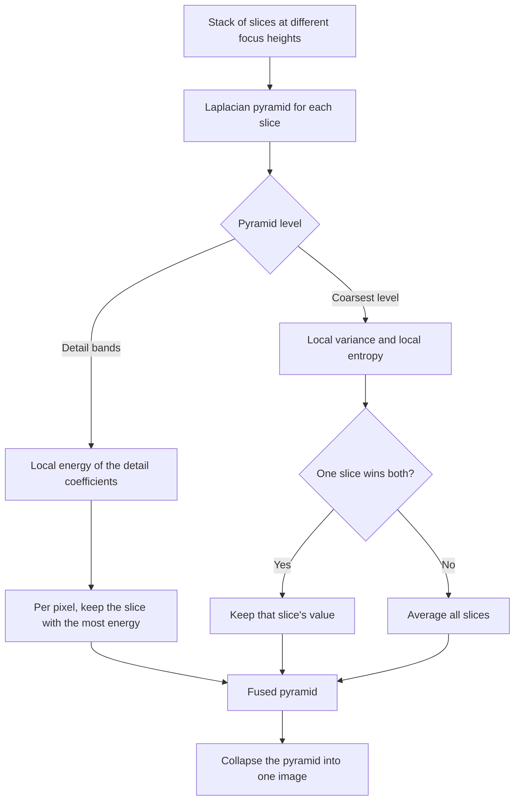

## The problem

At high magnification a microscope's depth of field is thinner than the specimen, so no single image is sharp everywhere. Focus stacking fixes this: capture the same field at several heights, then merge the in-focus parts of each into one all-in-focus image.

## Demo

These images are generated, not real microscope data. I made a field of textured "cells" on a tilted, slightly domed slide, then blurred it by each pixel's distance from five focus heights. Each slice is sharp in only one band. The fused result, produced by my stacking code, is sharp across the whole field.

<video src="/work/laplacian-focus-stacking/demo.mp4" poster="/work/laplacian-focus-stacking/thumbnail.jpg" controls preload="metadata" playsinline style="width:100%;border-radius:12px"></video>

## How it works

Fusion happens in the **Laplacian pyramid** domain, not on raw pixels. Each slice is split into band-pass "detail" layers, from fine edges down to broad shapes, plus a small low-frequency residual. Fusing one frequency band at a time avoids the seams and halos that come from cutting and pasting pixels.

1. **Decompose.** For every slice, repeatedly blur and downsample (`pyrDown`) to build a Gaussian pyramid. Subtract each level's upsampled successor to get the signed Laplacian (detail) bands.
2. **Fuse the detail bands: most local energy wins.** For each coefficient, compute the region energy: a small Gaussian-weighted sum of squared detail values around it. Take the coefficient from whichever slice has the highest energy there. Sharp structure gives strong band-pass responses, and blur suppresses them, so this picks the in-focus slice locally.
3. **Fuse the coarsest level by vote.** The coarsest level carries overall brightness and large shapes, where energy alone is unreliable. Two focus measures vote, both computed in a small window: local variance and local entropy. If one slice wins both, its value is used. Otherwise the slices are averaged, which avoids abrupt tonal jumps.
4. **Reconstruct.** Upsample the residual, add the fused band for each level, and repeat up to full resolution. Clip to the valid intensity range.

The selection rules follow the multi-focus image fusion scheme of region energy for detail bands and a deviation-plus-entropy vote for the base level.

## Prototype to production

I prototyped the algorithm in Python with NumPy and OpenCV, then wrote the first C++ port for the production imaging pipeline. The port moves the windowed statistics to box filters, which compute local variance as E[x²] − E[x]², and fuses the low-frequency residual itself with the vote. It was later optimised further with the team.
