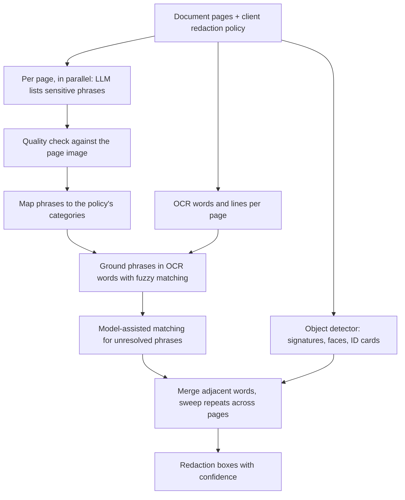

## The problem

Scanned documents had to be redacted by hand before they could be shared or processed further. What counts as sensitive varies by client, so the system had to follow a per-client policy. The policy lists the categories to redact, describes each in plain language, and names the items that must never be redacted.

## What I built

I built core parts of a redaction service that takes a document and returns precise redaction boxes with confidence scores. It returns boxes rather than flattened images, so downstream systems can review the boxes or apply them.

### How it works

1. **Per-page detection.** The document is split into pages and every page is processed concurrently. A language model reads each page and proposes the sensitive phrases and their categories, driven by the policy's descriptions and its do-not-redact list.
2. **Quality control.** A second pass shows the model the original page image alongside its own list. It drops false positives and adds anything it missed.
3. **Grounding in OCR geometry.** The model's coordinates for text are not trusted. Each phrase is matched to the OCR engine's word boxes, using several methods in turn:
   - fuzzy word and line matching
   - a model-assisted fallback that maps hard phrases to specific OCR lines
   - a sweep that finds the same value repeated on other pages
4. **Box assembly.** Matched words that sit next to each other are merged into one box. Each box carries a confidence derived from the OCR.
5. **Visual identifiers.** An object detector finds signatures, faces and identity cards and adds them to the same output. It was later moved behind a shared inference server.

### My contributions

- Merging multi-word redactions into single boxes.
- Agent-based localization of phrases to OCR lines, plus the hybrid fallback chain (agent → fuzzy matching → missing-match sweep).
- Do-not-redact handling, and grounding detected phrases to the policy's categories.
- Rewriting the detection prompts, and moving the agents to a configuration-driven factory.
- Integrating the visual detector with the shared inference server.

## Outcome

Manual effort reduced by about 80%.
