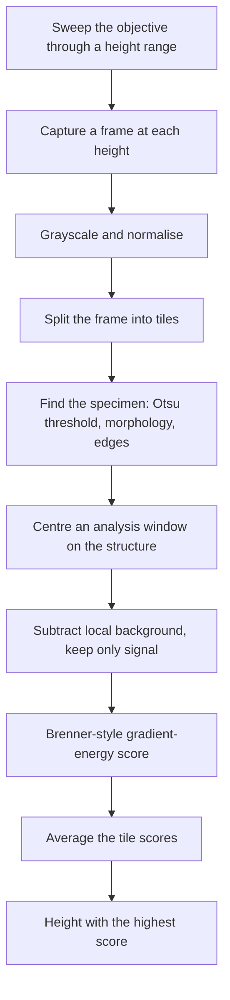
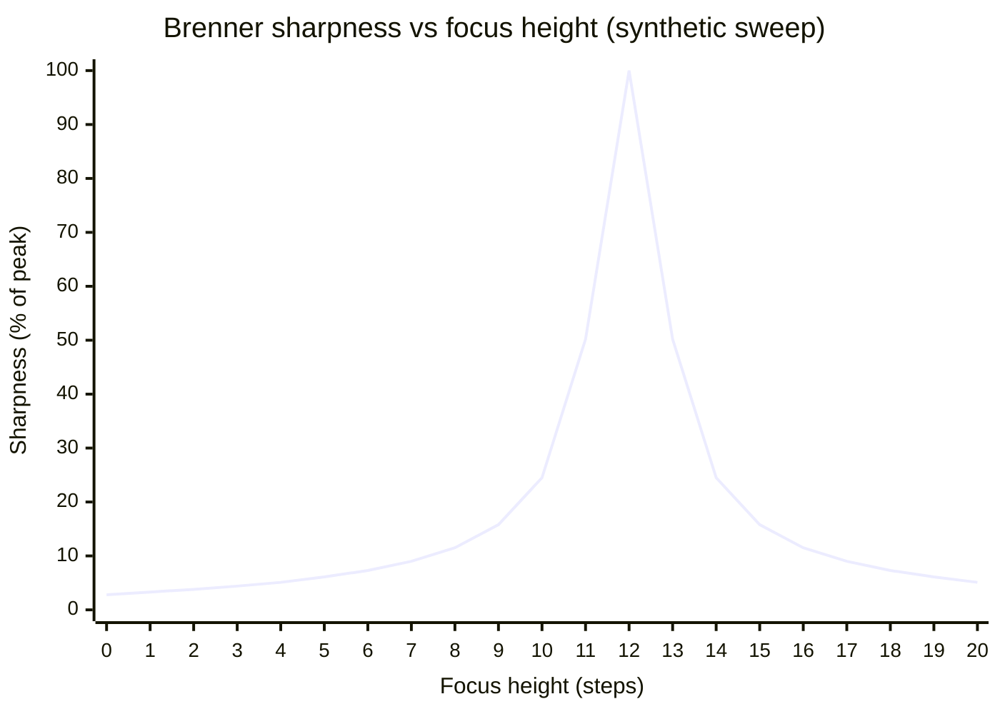

## The problem

Autofocus on an automated microscope comes down to one question asked many times: *how sharp is this frame?* The objective sweeps through a range of heights while the camera streams frames. Each frame gets a sharpness score, and the height with the highest score wins. The hard part is the score itself. A naive metric computed over the whole frame is easily fooled by empty background, uneven illumination and sensor noise, because they all add "texture" that has nothing to do with focus.

## What I built

I built the focus-evaluation stage in C++ with OpenCV. It returns a *(height, sharpness)* pair for each frame, so any search strategy can sit on top of it.

### How the score works

1. **Find the specimen first.** The frame is split into tiles. In each tile, the foreground is separated from the background with Otsu thresholding and cleaned with morphological opening and closing. Edges of the foreground mask give the structure's outline, and image moments give its centroid.
2. **Analyse only what matters.** An analysis window is centred on that structure. Inside it, the local mean is subtracted and negative values are clipped, so only above-background signal remains.
3. **Gradient energy.** Sharpness is measured with a variant of the **Brenner focus function**, which sums intensity differences between pixels a few steps apart. In-focus edges give large differences, and blur flattens them. The tile scores are averaged into one value per frame.
4. **High-magnification mode.** A second mode averages neighbouring pixel pairs before differencing, which is equivalent to a small box filter ahead of the gradient. This makes the measure much less sensitive to pixel-level noise at high magnification.

## Illustration

The chart below shows the textbook Brenner gradient on a *synthetic* image (not company data) blurred more and more the further it is from the true focus height. The sharp peak is what the search looks for.

Sharpness peaks at height 12 and halves one step either side. That steep response is what makes the argmax search reliable.
