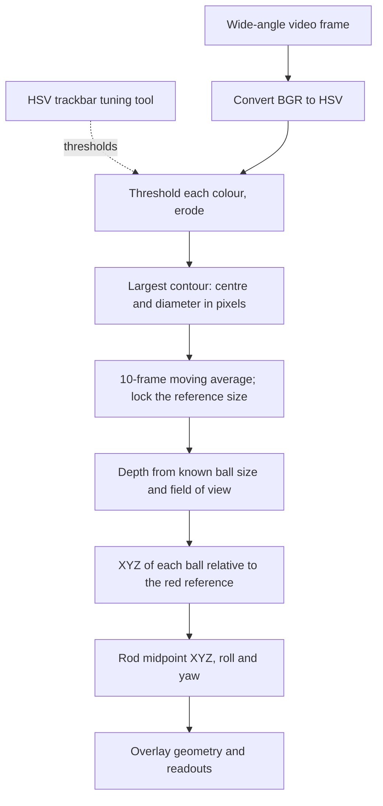

## What it does

Estimates the 3D position and orientation of a hand-held rod from one wide-angle camera, with no depth sensor or stereo rig. The rod carries two coloured balls (green and blue). A red ball fixed in the scene is the spatial reference. The overlay shows the rod midpoint's X/Y/Z in centimetres and its roll and yaw in degrees.

## Demo

I ran the project on its recorded test video to produce this output.

<video src="/work/monocular-3d-pose-estimation/demo.mp4" poster="/work/monocular-3d-pose-estimation/thumbnail.jpg" controls preload="metadata" playsinline style="width:100%;border-radius:12px"></video>

## How it works

1. **Segment by colour.** Each frame is converted to HSV and each ball is isolated with colour thresholds. I tuned the thresholds with a small OpenCV trackbar tool built for the project. One erosion removes speckle, and the largest contour gives each ball's centre and apparent diameter.
2. **Smooth.** A 10-frame moving average on position and diameter suppresses jitter. The reference ball is static, so its diameter is locked once it settles.
3. **Range from geometry, not learning.** The ball's known physical diameter divided by its diameter in pixels gives a centimetres-per-pixel scale. The camera's field of view turns the ball's pixel offset from the optical axis into a viewing angle. Range follows from the tangent relation, which for small angles is the pinhole model Z ≈ f·D/d.
4. **Relative pose.** Each ball's X/Y/Z is expressed relative to the reference ball. The rod's midpoint gives its position. The vector between the two balls gives yaw, and comparing the rod's known length with its projected length gives roll.
5. **Validate first.** Before moving to the wide-angle setup, I validated the size-based ranging on a calibrated, lens-undistorted camera, with a target at measured distances from 7 to 40 cm. I plotted computed range against ground truth.
