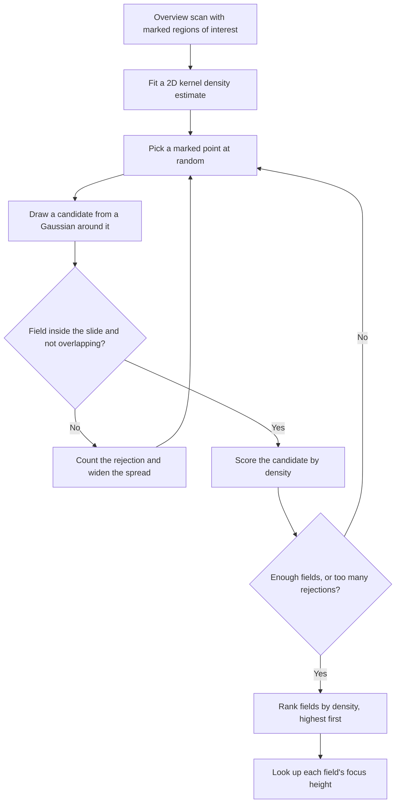

## The problem

High-magnification imaging is slow, so an automated slide scanner can't photograph every square millimetre. It has to decide *where* to look. After a quick low-magnification overview, a few regions of interest are marked. The scanner needs to turn those marks into a set of high-magnification fields of view that:

- are likely to contain cells
- don't overlap
- stay inside the scan area
- are ordered so the most promising fields are imaged first

## What I built

I built the probabilistic sampler that does this, and the [focus map](/work/z-plane-interpolation) that gives every sampled field its focus height.

### How it works

1. **Model the cells as a distribution.** The marked points are treated as samples from an unknown spatial distribution of cells. A two-dimensional **Gaussian kernel density estimate** turns them into a smooth probability surface over the slide. The bandwidth on each axis is chosen automatically with **Silverman's rule of thumb**.
2. **Propose candidates.** A mark is picked at random, and a candidate field centre is drawn from a Gaussian around it. Candidates therefore cluster where the cells are.
3. **Enforce hard constraints.** The candidate's field-of-view footprint must lie entirely inside the scan area and must not overlap any field already accepted. This makes the sampler a density-guided, non-overlapping placement scheme.
4. **Adapt instead of stalling.** As the dense areas fill up, candidates are rejected more often. The proposal spread then widens logarithmically with the number of rejections, so the sampler moves outward instead of getting stuck. A safety cap stops it cleanly if the area is exhausted.
5. **Rank.** Accepted fields are scored by the density at their centre and sorted, so the instrument visits the most promising locations first. With no marks, the sampler falls back to uniform coverage.
