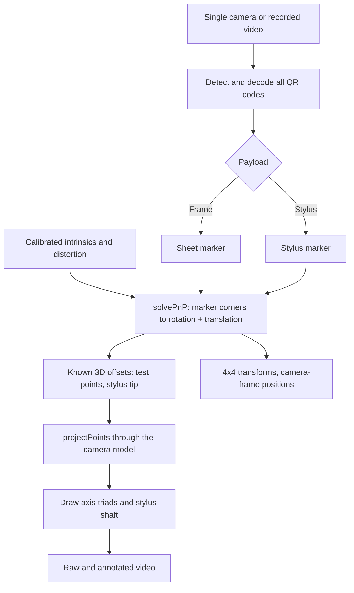

## What it does

Locates a hand-held stylus relative to a fixed test sheet in full 3D, with an ordinary webcam and two printed QR markers: one fixed to the sheet, one on the stylus. The aim was millimetre-level tracking of the stylus tip against a set of surveyed test points on the sheet.

## Demo

This is the tool's own annotated output. The RGB axis triads are drawn at the sheet's test points and along the stylus shaft. They are reprojected from the estimated poses, so when they line up with the real crosses on the paper, the calibration and pose are correct.

<video src="/work/qr-stylus-6dof-tracking/demo.mp4" poster="/work/qr-stylus-6dof-tracking/thumbnail.jpg" controls preload="metadata" playsinline style="width:100%;border-radius:12px"></video>

## How it works

1. **Calibrate the camera.** The camera has a pinhole intrinsic matrix and five Brown–Conrady distortion coefficients (radial k₁, k₂, k₃ and tangential p₁, p₂). These were calibrated once and rescaled to the working resolution.
2. **Detect and identify.** Each frame, OpenCV's multi-QR detector finds and decodes every marker. The payload says which marker is the fixed frame and which is the stylus.
3. **Solve the pose.** Each marker's four corners are modelled as a planar square of known size and passed to **Perspective-n-Point** (`cv2.solvePnP`). This returns the marker's full rotation (Rodrigues vector) and translation in camera coordinates.
4. **Use the object geometry.** The test points are defined in the sheet marker's frame, and the shaft and tip in the stylus marker's frame. They are reprojected through the calibrated model (`cv2.projectPoints`) and drawn as axis triads, which gives an immediate visual check of pose quality.
5. **Record.** Poses are converted into 4×4 homogeneous transforms. Raw and annotated video are recorded for evaluation.

The QR pose estimation started from the open-source [QR_code_orientation_OpenCV](https://github.com/TemugeB/QR_code_orientation_OpenCV) example (MIT). I extended it to multiple markers, marker identification by payload, and object-specific 3D geometry.
