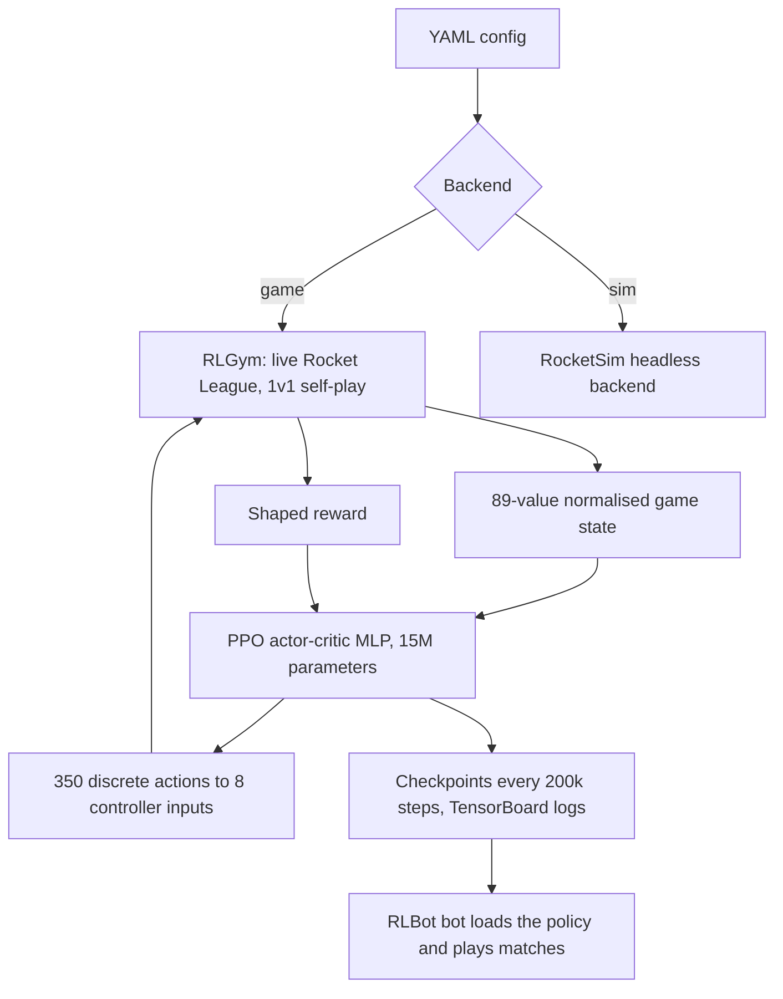

## What it does

A reinforcement-learning agent that learns to play Rocket League from scratch by playing against itself in the real game. The trained policy is packaged as an [RLBot](https://rlbot.org/)-compatible bot that plays full matches.

## How it works

1. **Environment.** [RLGym](https://rlgym.org/) connects to a live Rocket League instance. In a 1v1 match both cars are driven by the same policy, so every match produces two streams of experience. A configuration switch can also train headless in RocketSim.
2. **Observation.** An 89-dimensional normalised state vector:
   - ball position and velocities
   - each car's position, orientation vectors, velocities, boost, ground contact and flip availability
   - all 34 boost pads
   - the previous action

   The state is mirrored for the orange team, so one policy can play either side.
3. **Actions.** A 350-entry lookup table turns one discrete choice into all eight controller inputs (throttle, steer, pitch, yaw, roll, jump, boost, handbrake). It covers ground driving, aerials and flips.
4. **Reward shaping.** The first curriculum stage rewards ball touches most heavily, plus velocity toward the ball, facing the ball and getting airborne. A second stage, defined but not yet trained, targets harder hits and aerial touches.
5. **Training.** PPO from Stable-Baselines3 with separate actor and critic MLPs (2048-2048-1024-1024, about 15M parameters). Rollouts are 20k steps with 5 optimisation epochs per update, and a checkpoint is saved every 200k steps.
6. **Deployment.** The RLBot agent decodes each live game packet into the same observation, runs the policy, maps the chosen index through the same action table, and holds the controls for the action interval.

## Training runs

These figures are from the TensorBoard logs. Policy entropy starts at ln 350 ≈ 5.86, which is a uniformly random policy, and falls as the agent commits to actions. Explained variance measures how well the value network predicts returns, where 1.0 is perfect.

| Run | Network | Timesteps | Wall time | Entropy start → end | Explained variance (end) |
|---|---|---|---|---|---|
| Long run | 512-512 | 20.4M | 12.2 h | 5.86 → 0.21 | 0.87 (peak 0.99) |
| Large network | 2048-2048-1024-1024 | 5.0M | 7.2 h | 5.86 → 2.39 | 0.78 |

Both runs trained on CPU against the live game, at about 460 and 190 steps per second respectively.
