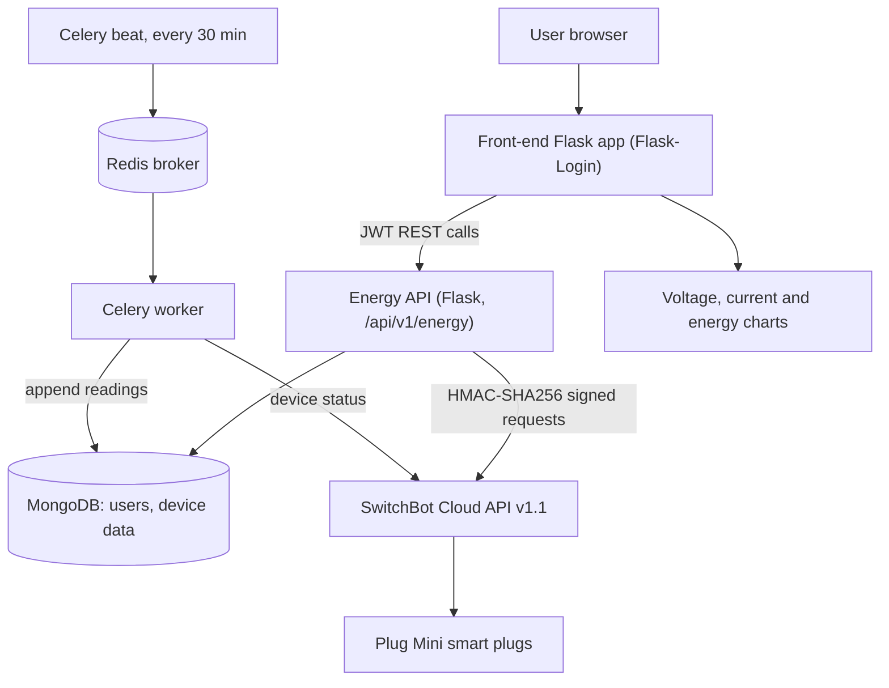

## What it does

Turns the SwitchBot Plug Mini cloud API into a consumption history for each appliance. Users create an account and link their SwitchBot Cloud credentials. The service then discovers their plugs, records voltage, current, power and on-time every 30 minutes, and shows each appliance's energy use with charts.

## How it works

1. **Signed API access.** Every request to the SwitchBot v1.1 API carries a signature: Base64(HMAC-SHA256(secret, token + millisecond timestamp + nonce)), with a fresh UUID nonce for each call.
2. **Device discovery.** Linking credentials triggers discovery of every plug on the account. Each plug is registered with an empty time series.
3. **Scheduled polling.** A Celery beat schedule, with Redis as the broker, wakes every 30 minutes. A worker polls every plug's status endpoint for line voltage, current, power and daily on-time, appends the readings to that device's series in MongoDB, and derives energy in watt-hours from power and on-time.
4. **Two services, one codebase.** A JSON REST API secured with `flask-jwt-extended` handles accounts, credential linking, device refresh and data retrieval. A separate server-rendered front end uses Flask-Login, with the API's JWT as the session identity. It lists each user's plugs with their accumulated energy and draws voltage, current and energy charts on demand. An app-factory structure with Celery task-context integration lets the API, worker and scheduler share one configuration.
5. **Testing without hardware.** A "dummy" credential mode generates synthetic plugs and readings. The whole pipeline (sign-up, discovery, scheduled polling, charting) can be exercised without a single device.
