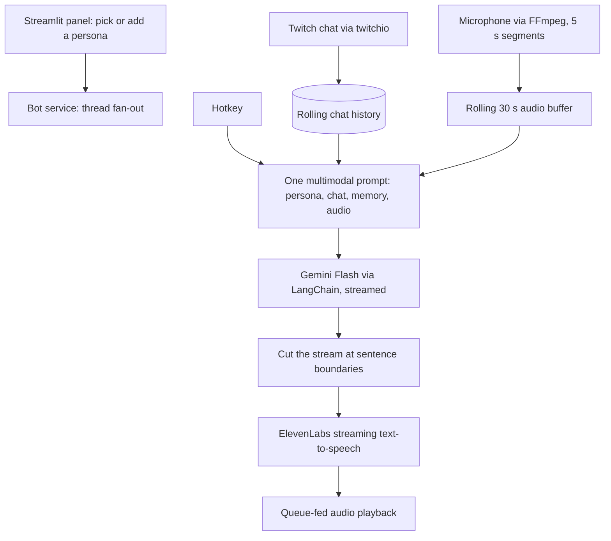

## What it does

A live-streaming co-host. It reads Twitch chat, listens to what the streamer has been saying, and answers out loud in a configurable character voice. The operator controls it from a small Streamlit panel, where they pick a persona or write a new one. A hotkey makes the co-host respond.

## How it works

1. **Concurrent service.** The bot runs as a multithreaded Python service next to the Streamlit UI. Separate threads handle the Twitch client, which runs an asyncio `twitchio` bot in its own event loop, the microphone recorder, the hotkey listener, the text-to-speech chunker and the audio player. A YouTube Live chat poller is also included; it follows the server's polling interval.
2. **Rolling microphone buffer.** One FFmpeg thread records the microphone in 5-second WAV segments. Another stitches the latest six together every second. The result is always the last 30 seconds of the streamer's voice, ready to send.
3. **One multimodal prompt.** When the hotkey fires, the bot sends Gemini a single prompt. It contains the persona, recent chat, the co-host's own last ten exchanges as short-term memory, the newest chat message, and the raw 30-second audio clip. Gemini transcribes and reasons over the audio in one pass, so there is no separate speech-to-text stage.
4. **Low-latency speech.** The reply streams token by token and is cut at sentence boundaries. Each sentence goes to ElevenLabs streaming text-to-speech while the model is still generating, and the MP3 chunks play through a queue. The delay before the co-host starts talking is roughly the time to produce the first sentence, not the whole answer.

## Client feedback

> Helped out step by step to understand the unique programs I was using, go through issues with the code, and set me up on my end to have it all work! Will definitely be returning for any and all of my coding needs!
