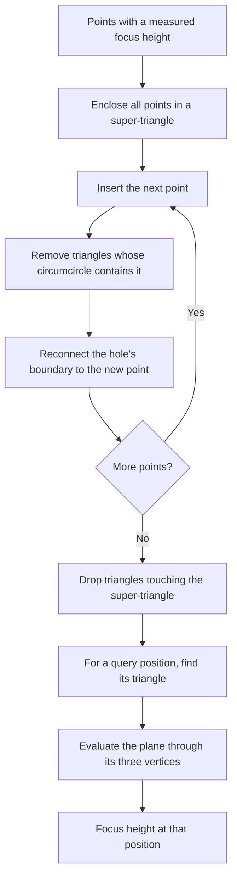

## The problem

A microscope slide is never perfectly flat. Tilt in the stage, the slide and the coverslip means the in-focus height drifts across the scan area. A full autofocus at every field would be far too slow. Instead, focus is measured at a few locations, and a **focus map** fills in everything else.

## What I built

I wrote the production focus map in C++ for an automated microscope. It turns a handful of focus measurements into a height for every field the scanner visits, including the fields chosen by the [density-guided sampler](/work/probabilistic-cell-sampler).

The production code is proprietary, so to show the idea I built a standalone Python/pygame version, which is open source: [Delaunay-Triangulation-Pygame](https://github.com/zainkhan-afk/Delaunay-Triangulation-Pygame). The demo below runs that code. Measurement points are added one at a time on a smooth, tilted and slightly domed "slide", and the colour shows the interpolated height.

<video src="/work/z-plane-interpolation/demo.mp4" poster="/work/z-plane-interpolation/thumbnail.jpg" controls preload="metadata" playsinline style="width:100%;border-radius:12px"></video>

## How it works

1. **Triangulate with Bowyer–Watson.** Start with a large "super-triangle" that encloses every point. Insert the points one at a time. For each new point, remove every triangle whose circumcircle contains it, keep the edges of the resulting polygonal hole that aren't shared, and connect each of them to the new point. Finally, remove any triangle that touches the super-triangle.
2. **Why Delaunay.** Delaunay triangles maximise the minimum angle and avoid long, thin slivers. Every location is therefore interpolated from nearby, well-spread measurements.
3. **Interpolate.** To get the height at any position, find the triangle that contains it and evaluate the plane through its three vertices. With normal **n** = (P₂ − P₁) × (P₃ − P₁) = (a, b, c) and d = **n**·P₁, the height is z = (d − a·x − b·y) / c, which is the same as barycentric interpolation.
4. **Production details.** The C++ version extends the mesh so it covers the whole scan area, not just the hull of the measured points. Each sampled field's position is turned into an objective height before imaging.
